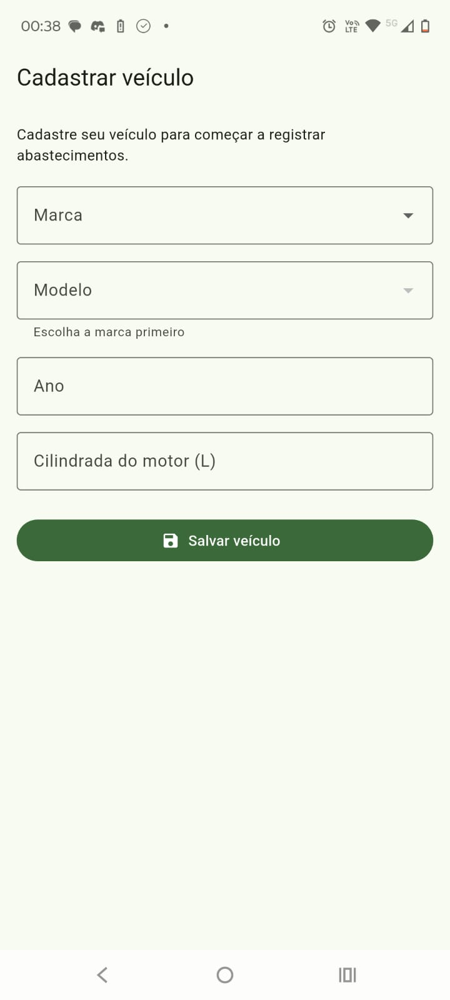
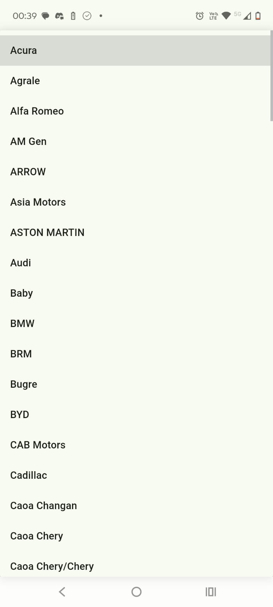
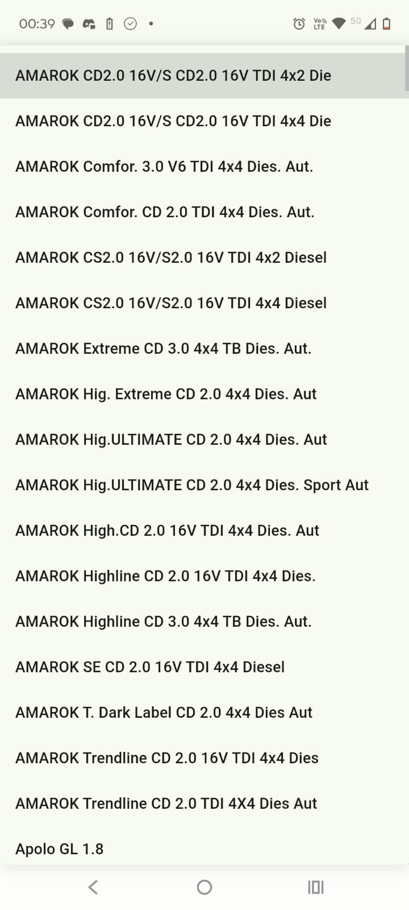
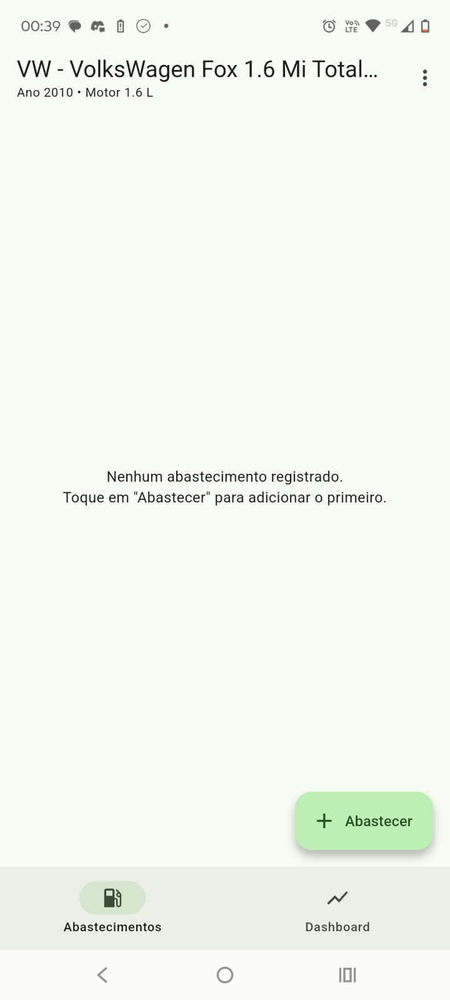
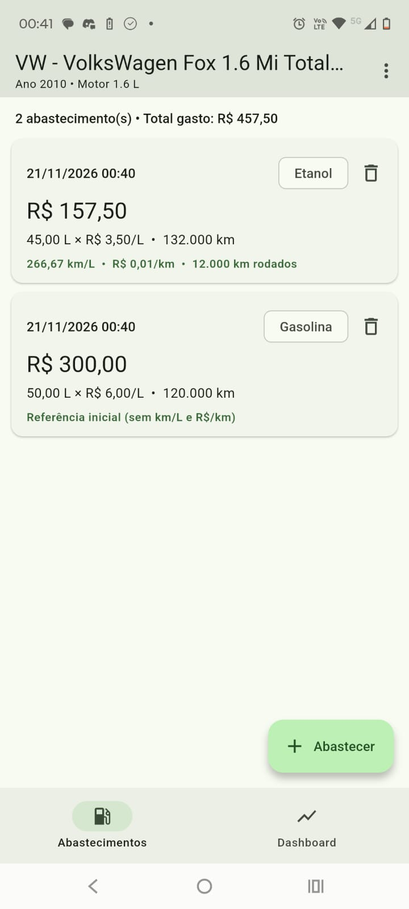
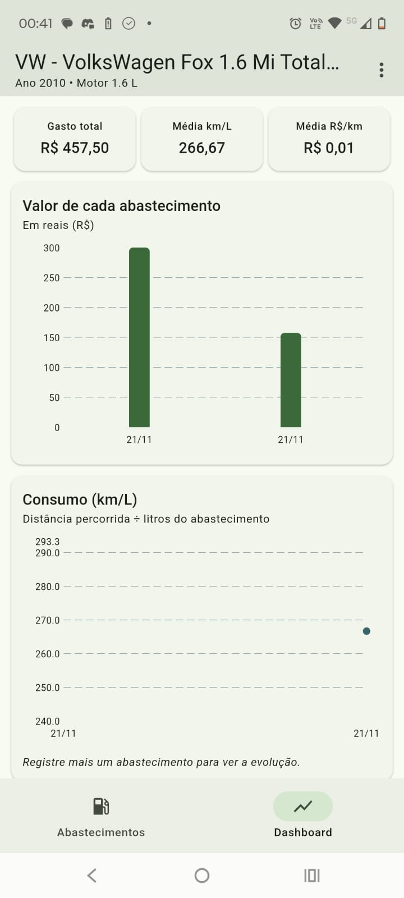

# ⛽ Controle de gastos com combustível


Aplicativo Flutter para registrar os abastecimentos de um veículo e acompanhar os gastos com combustível, o consumo e o custo por quilômetro ao longo do tempo.

Projeto individual de Bruno Berval para a **Atividade Substitutiva da Prova 1** de **Programação para Dispositivos Móveis I**, ministrada pelo Prof. Arley.

## 🚗 Funcionalidades

- **Cadastro de veículo** — registra um veículo por vez, com marca, modelo, ano e cilindrada. A consulta de modelos leva em conta a marca selecionada.
- **Registro de abastecimentos** — informa combustível (etanol, gasolina ou diesel), preço por litro em reais, quilometragem, litros, data e horário. O aplicativo calcula o valor total automaticamente.
- **Persistência local** — mantém o veículo e os abastecimentos disponíveis após fechar e reabrir o app. A exclusão do veículo pede confirmação e remove os abastecimentos vinculados.
- **Dashboard** — mostra o valor de cada abastecimento e a evolução do consumo e do custo por quilômetro em gráficos.

## 📊 Cálculo dos indicadores

Cada registro representa um abastecimento que completa o tanque. O primeiro registro serve de referência e exibe apenas o valor total. O consumo e o custo por quilômetro são calculados a partir do segundo abastecimento, em ordem cronológica.

| Indicador | Cálculo |
| --- | --- |
| Valor total (R$) | Preço por litro × litros abastecidos |
| Distância (km) | Quilometragem atual − quilometragem anterior |
| Consumo (km/L) | Distância ÷ litros do abastecimento atual |
| Custo (R$/km) | Valor do abastecimento atual ÷ distância |

## ▶️ Como executar

Tenha o Flutter instalado com uma versão do Dart compatível com o [pubspec.yaml](combustivel_app/pubspec.yaml). Inicie um emulador Android ou conecte um aparelho com a depuração USB ativada. O dispositivo precisa de internet para consultar marcas e modelos.

```bash
git clone https://github.com/BrunoBerval/atividadeP1.git
cd atividadeP1/combustivel_app
flutter pub get
flutter run
```

Para executar a análise estática e os testes a partir de `combustivel_app/`:

```bash
flutter analyze
flutter test
```

## 🧰 API e bibliotecas

O app consulta a **BrasilAPI (FIPE)** para obter marcas e modelos de veículos. [Documentação da BrasilAPI](https://brasilapi.com.br/docs#tag/FIPE)

| Biblioteca | Uso no projeto |
| --- | --- |
| `http` | Requisições à BrasilAPI |
| `sqflite` e `path` | Banco de dados SQLite e caminho do arquivo local |
| `fl_chart` | Gráficos do dashboard |
| `provider` | Gerenciamento de estado |
| `intl` e `flutter_localizations` | Formatação de valores e datas e interface em português do Brasil |

## 📸 Capturas de tela

| Tela inicial | Seleção de marca | Seleção de modelo |
| --- | --- | --- |
|  |  |  |

| Lista de abastecimentos vazia | Lista com dois abastecimentos | Dashboard |
| --- | --- | --- |
|  |  |  |
